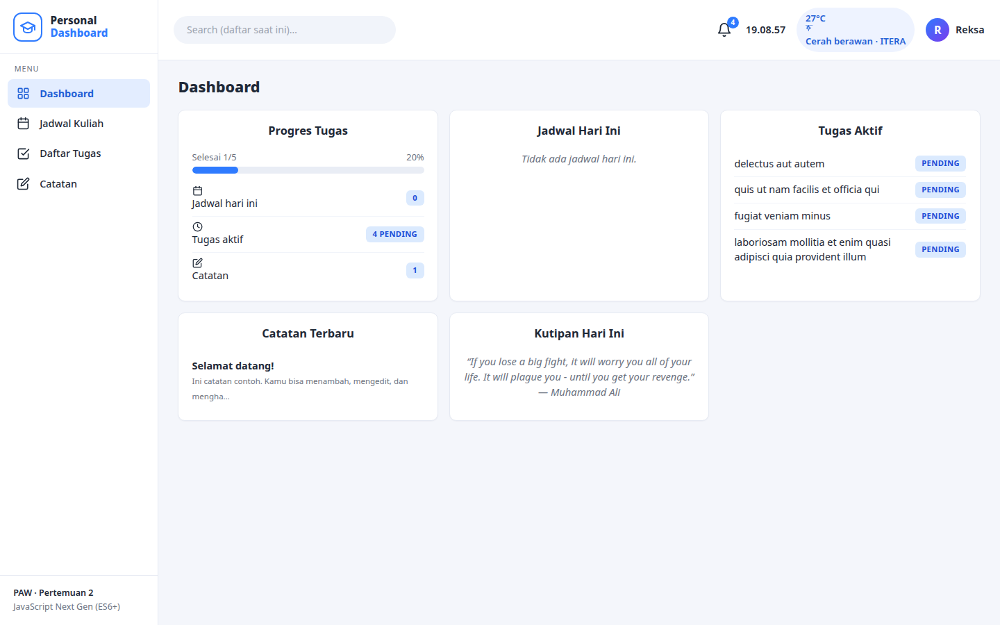
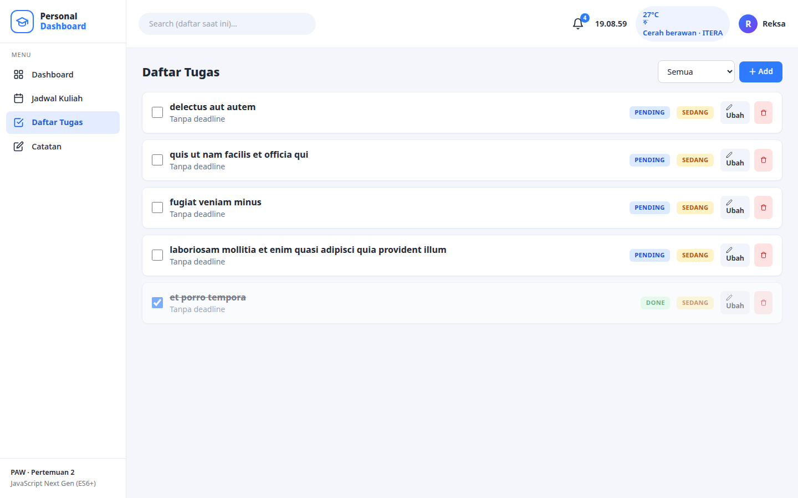

# Personal Dashboard — Tugas Praktikum PAW Pertemuan 2

**Mata kuliah:** Pengembangan Aplikasi Web (PAW) · **Pertemuan 2:** JavaScript Next Gen (ES6+)

## Deskripsi Aplikasi

Personal Dashboard adalah aplikasi web asisten harian mahasiswa dalam satu tempat, dengan tampilan terinspirasi **Personal Management System** (sidebar navigasi, topbar dengan pencarian, kartu widget, dan badge status):

- **📊 Dashboard** — overview widget: progres tugas (progress bar), jadwal hari ini, tugas aktif, catatan terbaru, dan kutipan harian.
- **📅 Jadwal Kuliah** — tambah, ubah, dan hapus jadwal (hari, mata kuliah, jam, ruangan). Otomatis diurutkan per hari.
- **✅ Daftar Tugas** — tambah, ubah, hapus, dan tandai selesai. Dilengkapi deadline, badge prioritas (Tinggi/Sedang/Rendah), badge status DONE/PENDING ala PMS, dan filter (Semua / Belum selesai / Selesai).
- **📝 Catatan** — tambah, ubah, dan hapus catatan bebas dengan stempel waktu otomatis.
- **🔍 Pencarian topbar** — filter daftar yang sedang dibuka secara real-time.
- **🔔 Lonceng** — badge jumlah tugas aktif, klik untuk lompat ke daftar tugas.
- **Widget cuaca real-time** kampus ITERA di topbar (Open-Meteo, async/await).
- **Penyimpanan lokal** — seluruh data jadwal, tugas, dan catatan tersimpan di `localStorage` browser (`paw_dashboard_v1`) dan bertahan setelah refresh. Saat pertama dibuka, daftar tugas di-seed dari JSONPlaceholder.

## Cara Menjalankan

> Jangan buka `index.html` dengan double-click (protokol `file://`) — modul ES (`type="module"`) akan diblokir browser karena CORS.

1. Buka folder project di VS Code.
2. Klik kanan `index.html` → **Open with Live Server**.
3. Atau serve manual: `python3 -m http.server 8000` lalu buka `http://localhost:8000`.

## Screenshot


*Dashboard: sidebar navigasi, topbar (search, jam, cuaca, profil), dan widget overview ala Personal Management System.*


*Daftar tugas dengan badge status PENDING/DONE, badge prioritas, dan filter.*

## Fitur ES6+ yang Diimplementasikan

| Fitur | Lokasi | Keterangan |
|---|---|---|
| `let` / `const` | seluruh file `js/` | `const` untuk state & helper, `let` untuk `list` yang di-assign ulang (`js/app.js:225`), `editing` (`js/main.js:97`) |
| Arrow functions (10+) | `js/modules/utils.js:4–41` | `$`, `uid`, `escapeHtml`, `formatTanggal`, `jamSekarang`, dll. |
| Template literals | `js/app.js` (24 blok backtick), `js/main.js:118–138` | Semua rendering HTML dinamis memakai backtick + `${}` |
| Destructuring | `js/app.js:59`, `js/main.js:140` | `const { current } = await res.json()`, `const { action, id, kind } = el.dataset` |
| Spread / Rest | `js/app.js:90, 96, 111` | Update state immutable: `{ ...this.state, jadwal: [...this.state.jadwal, ...] }` |
| Default parameters | `js/modules/utils.js:4,13,30`, `js/modules/data.js:8` | Mis. `(selector, el = document)`, `(str = '')`, `(ts = Date.now())` |
| Classes | `js/modules/data.js:7` (`TaskItem`), `js/app.js:7` (`DashboardApp`) | `TaskItem` punya method `toggled()` & getter `isOverdue`; `DashboardApp` mengelola state, storage, dan fetch |
| Modules (import/export) | `index.html:71` (`type="module"`), `js/main.js:3–5`, `js/app.js:3–4` | `utils.js` & `data.js` di-export, di-import oleh `app.js` & `main.js` |
| Array methods modern | `js/app.js:36, 97, 103, 118, 165–171` | `map`, `filter`, `find`, `sort` untuk render & CRUD |
| Async/await | `js/app.js:16–27, 55–69` | `init()`, `fetchCuaca()` (Open-Meteo), `fetchKutipan()` (DummyJSON), `Promise.allSettled` paralel |
| Promises (`.then`) | `js/app.js:71–86` | `seedTugas()` dari JSONPlaceholder dengan chaining `.then().catch()` |
| Optional chaining & nullish | `js/app.js:36`, `js/main.js:62` | `parsed.jadwal ?? []`, `$(...)?.classList`, `item?.[f.name]` |
| `Object.fromEntries` + `FormData` | `js/main.js:142`, `js/app.js:194` | Mengambil data form modal menjadi objek; mapping urutan hari |

## Struktur Project

```
tugas-paw-pertemuan-2/
├── index.html          # halaman utama (tab jadwal/tugas/catatan + modal)
├── css/style.css       # styling kustom (di atas Tailwind CDN)
├── js/main.js          # entry point: tab, modal, event delegation, jam live
├── js/app.js           # class DashboardApp (state, localStorage, fetch, render)
├── js/modules/utils.js # helper: $, uid, escapeHtml, format tanggal/jam
├── js/modules/data.js  # class TaskItem + data seed awal
├── screenshots/        # screenshot antarmuka
└── README.md
```

## Catatan

Data contoh (3 jadwal + 1 catatan) adalah seed awal dan bisa dihapus/diubah langsung dari aplikasi. Tugas awal di-seed otomatis dari JSONPlaceholder hanya saat `localStorage` masih kosong.
