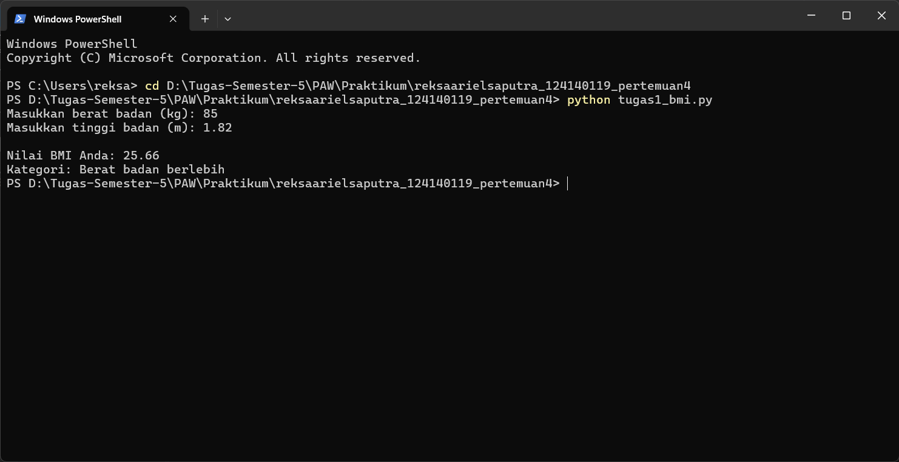
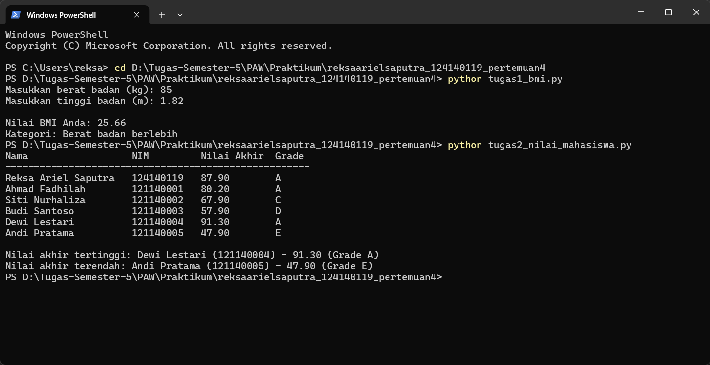
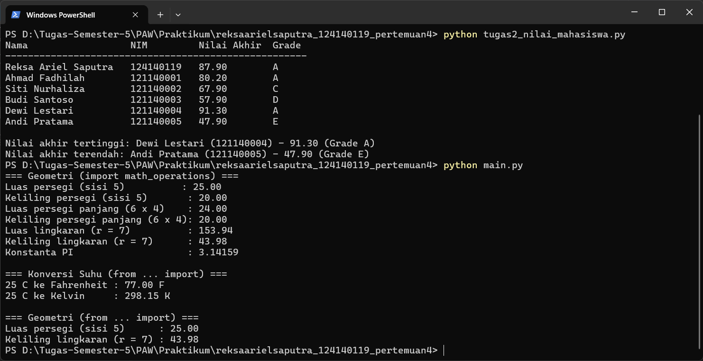

# Praktikum PAW — Pertemuan 4: Dasar Pemrograman Python

**Nama:** Reksa Ariel Saputra
**NIM:** 124140119

## Deskripsi

Tiga program sesuai halaman tugas pertemuan 4:

1. **Soal 1 — `tugas1_bmi.py` (30%)**
   Menghitung BMI dari berat (kg) dan tinggi (m) yang diinput lewat terminal,
   dengan rumus `BMI = berat / (tinggi * tinggi)`, lalu menentukan kategori
   lewat `if-elif-else`: < 18,5 kurang, 18,5–<25 normal, 25–<30 berlebih,
   ≥ 30 obesitas. Hasil dicetak dengan 2 angka desimal (f-string).
2. **Soal 2 — `tugas2_nilai_mahasiswa.py` (40%)**
   List berisi 6 dictionary mahasiswa (`nama`, `nim`, `nilai_uts`,
   `nilai_uas`, `nilai_tugas`). Nilai akhir = 30% UTS + 40% UAS + 30% Tugas,
   grade A (≥80), B (70–79), C (60–69), D (50–59), E (<50). Output berupa
   tabel rapi plus mahasiswa nilai tertinggi dan terendah.
3. **Soal 3 — `math_operations.py` + `main.py` (30%)**
   Modul berisi fungsi luas & keliling persegi, persegi panjang, dan
   lingkaran; konversi Celsius ke Fahrenheit dan ke Kelvin; serta konstanta
   `PI = 3.14159`. `main.py` memanggil seluruh fungsi dengan dua cara impor
   berbeda (`import math_operations` dan `from math_operations import ...`).

Setiap fungsi memakai docstring, indentasi 4 spasi, dan penamaan snake_case
(PEP 8).

## Cara Menjalankan

```bash
python tugas1_bmi.py
python tugas2_nilai_mahasiswa.py
python main.py
```

Di Windows, kalau `python` tidak dikenali, pakai `py` atau `python3`.

## Screenshot Hasil Eksekusi

- Soal 1:

- Soal 2:

- Soal 3:

