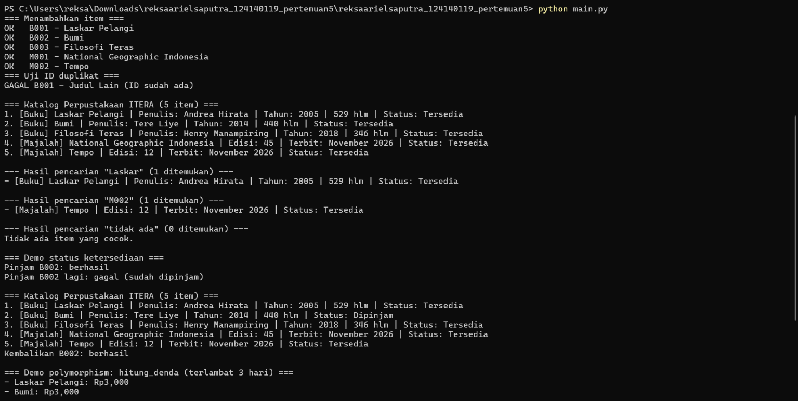

# Praktikum PAW — Pertemuan 5: Sistem Manajemen Perpustakaan (Python OOP)

**Nama:** Reksa Ariel Saputra
**NIM:** 124140119
**Kelas Praktikum:** RB

## Deskripsi Program

Sistem manajemen perpustakaan sederhana yang menerapkan 4 pilar OOP:

1. **Class** — Tiga class utama: `LibraryItem` (abstract), `Book`, `Magazine`,
   dan `Library` sebagai pengelola koleksi.
2. **Inheritance** — `Book` dan `Magazine` mewarisi `LibraryItem` dan
   mengimplementasikan kedua method abstract-nya (`get_detail` dan
   `hitung_denda`).
3. **Encapsulation** — Atribut identitas (`item_id`, `judul`, `tahun_terbit`,
   `penulis`, `jumlah_halaman`, `edisi`, `bulan_terbit`) bersifat private
   dan hanya bisa dibaca lewat property; koleksi `Library` tersimpan di
   atribut private `__koleksi` dan hanya bisa diubah lewat method
   `tambah_item`, `pinjam_item`, dan `kembalikan_item`. Status peminjaman
   diubah lewat property `is_dipinjam` yang memvalidasi tipe boolean.
4. **Polymorphism** — Method `get_detail()` dan `hitung_denda()` yang sama
   menghasilkan output berbeda per subclass: buku menampilkan penulis dan
   jumlah halaman dengan denda Rp1.000/hari, majalah menampilkan edisi dan
   bulan terbit dengan denda Rp500/hari. `Library.tampilkan_katalog()`
   memanggil `get_detail()` tanpa perlu tahu jenis itemnya.

### Alur program (`main.py`)

1. Membuat `Library`, lalu menambahkan 3 buku dan 2 majalah.
2. Menguji penolakan ID duplikat (`B001` kedua ditolak).
3. Menampilkan katalog lengkap beserta status ketersediaan.
4. Mencari item berdasarkan judul (`"Laskar"`), berdasarkan ID (`"M002"`),
   dan kata kunci yang tidak ada.
5. Demo pinjam/kembalikan satu buku (`B002`), termasuk percobaan pinjam
   kedua yang ditolak karena sudah dipinjam.
6. Demo polymorphism: `hitung_denda(3)` untuk semua item.

### Struktur berkas

- `library_item.py` — Abstract class `LibraryItem(ABC)` + subclass `Book`
  dan `Magazine`, lengkap dengan property decorator (`@property`).
- `library.py` — Class `Library` dengan koleksi private `__koleksi`,
  method tambah item, tampilkan katalog, cari item (judul/ID),
  pinjam dan kembalikan item.
- `main.py` — Skrip demo seluruh fungsionalitas sistem.
- `README.md` — Dokumentasi ini.

## Cara Menjalankan

```bash
python main.py
```

Di Windows, kalau `python` tidak dikenali, pakai `py` atau `python3`.
Tidak ada library eksternal — cukup Python 3 standar.

## Screenshot Hasil Eksekusi

